                                            SULVA Accounting System

SULVA Accounting System is an Android-based accounting application developed using Kotlin to support financial record management and essential accounting operations. The system brings together account management, journal entries, customer and supplier records, invoice processing, payment tracking, and financial reporting in one application.

The project demonstrates the practical application of software engineering, database management, and accounting principles in developing a structured computerized accounting solution.

---

Table of Contents

- "Project Overview" (#project-overview)
- "Objectives" (#objectives)
- "Features" (#features)
- "Technologies Used" (#technologies-used)
- "Database Structure" (#database-structure)
- "Application Screenshots" (#application-screenshots)
- "Testing" (#testing)
- "Installation and Setup" (#installation-and-setup)
- "Future Improvements" (#future-improvements)
- "Author" (#author)

---

Project Overview

SULVA Accounting System was developed to organize and simplify essential accounting activities through an Android application.

The application provides functionality for recording and retrieving financial information, managing accounts, monitoring customer and supplier transactions, tracking invoices and payments, and generating accounting reports.

Room Database is used for local data persistence, allowing the application to store and manage accounting records on the device.

The system is designed to provide a structured approach to financial record management and demonstrate the implementation of accounting functions through software development.

Objectives

The main objectives of the SULVA Accounting System are to:

- Provide a structured method for recording and managing financial information.
- Support account management and journal entry recording.
- Organize accounting transactions through the General Ledger.
- Facilitate customer and supplier record management.
- Support invoice processing and payment tracking.
- Provide access to essential accounting reports.
- Apply database management and software engineering principles in developing an Android accounting application.

---

Features

1. Accounting and Financial Management

- Chart of Accounts management.
- Journal entry recording.
- General Ledger transaction review.
- Financial transaction organization.
- Account balance monitoring.

2. Customer Management

- Customer record management.
- Customer invoice recording.
- Customer payment recording.
- Accounts Receivable monitoring.
- Tracking of outstanding customer balances.

3. Supplier Management

- Supplier record management.
- Supplier invoice recording.
- Supplier payment recording.
- Accounts Payable monitoring.
- Tracking of outstanding supplier obligations.

4. Financial Reporting

- Trial Balance generation.
- Accounts Receivable reporting.
- Accounts Payable reporting.
- Access to available accounting reports.
- Presentation of relevant financial information.

5. Data Management

- Local data storage using Room Database.
- Structured database entities for accounting records.
- Data validation for supported input conditions.
- Data persistence.
- Database versioning and migrations.

---

Technologies Used

Technology| Purpose
Kotlin| Primary programming language
Android Studio| Android application development environment
Room Database| Local database storage and persistence
SQLite| Underlying database technology used by Room

Note: The table reflects the technologies identified for the project. Additional libraries or technologies should be included where applicable.

---

Database Structure

The SULVA Accounting System uses Room Database to organize and manage its application data.

The database contains the following entities:

No.| Entity| Purpose
1| Account| Stores account information.
2| Category| Organizes transaction categories.
3| Transaction| Stores financial transaction records.
4| Budget| Supports budget management.
5| SavingsGoal| Stores savings goal information.
6| RecurringTransaction| Manages recurring transaction records.
7| Settings| Stores application settings.
8| ChartOfAccount| Stores the structured chart of accounts.
9| JournalEntry| Stores journal entry records.
10| JournalLine| Stores the individual lines associated with journal entries.
11| Customer| Stores customer information.
12| CustomerInvoice| Stores customer invoice records.
13| CustomerPayment| Stores customer payment records.
14| Supplier| Stores supplier information.
15| SupplierInvoice| Stores supplier invoice records.
16| SupplierPayment| Stores supplier payment records.

These entities support the organization of accounting information and provide the database foundation for the application's major modules.

Database migrations are used to accommodate supported changes to the database structure as the application evolves.

---

Application Screenshots

The following screenshots showcase the application's existing user interface.

<table>
  <tr>
    <td>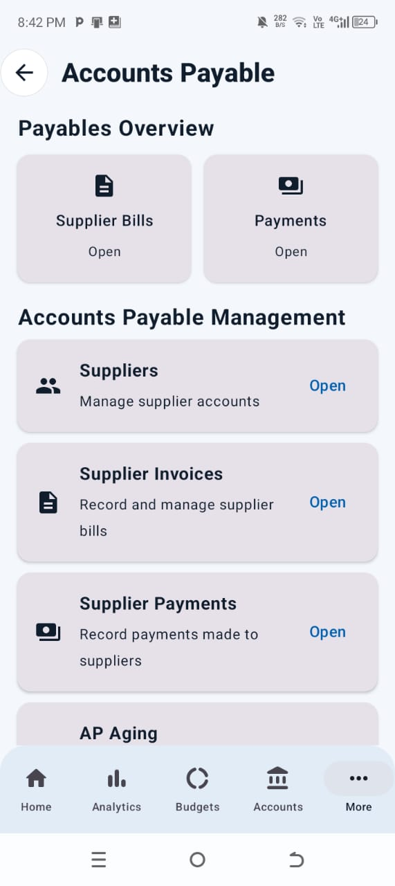</td>
    <td>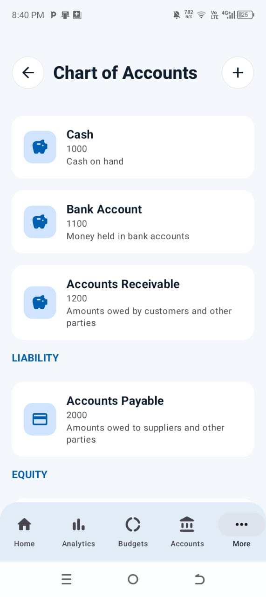</td>
    <td>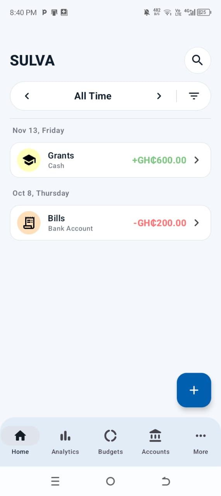</td>
    </tr>
  <tr>
    <td>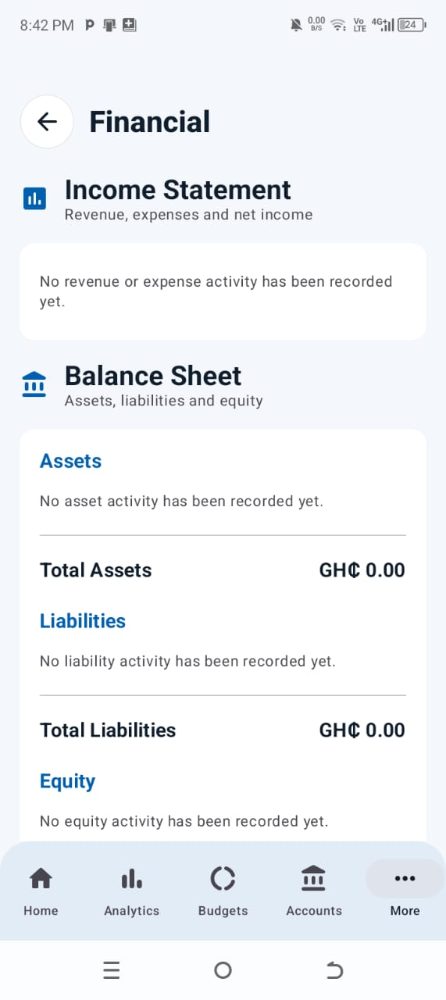</td>
    <td>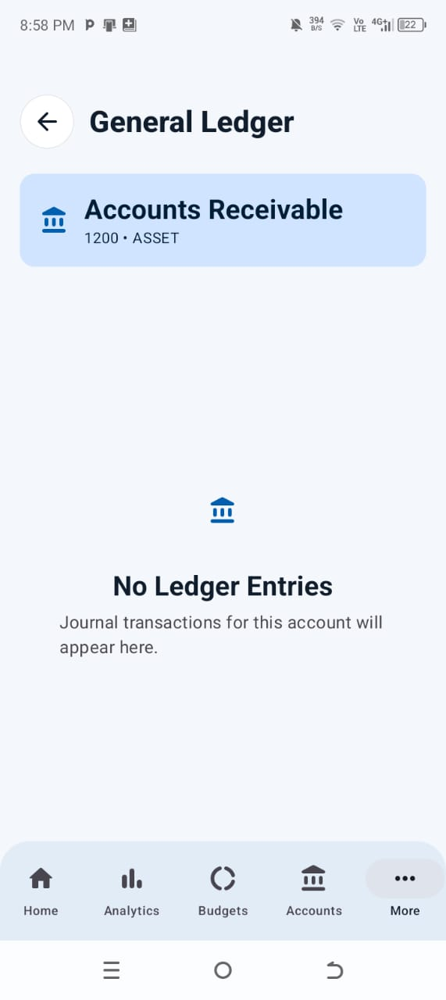</td>
    <td>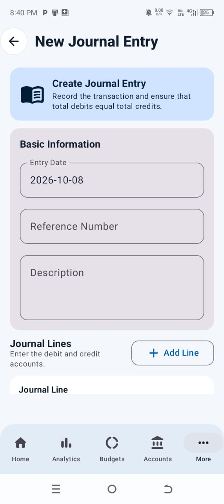</td>
    <td>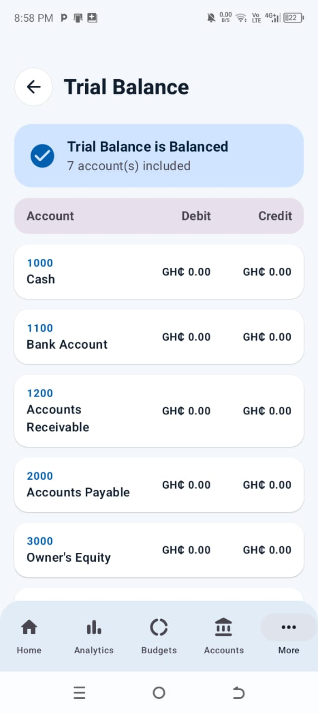</td>
</tr>
</table>

---
Database Designs Implementation
The existing Application's Database schema of the SULVA Application is as follows:

<table>
  <tr>
    <td>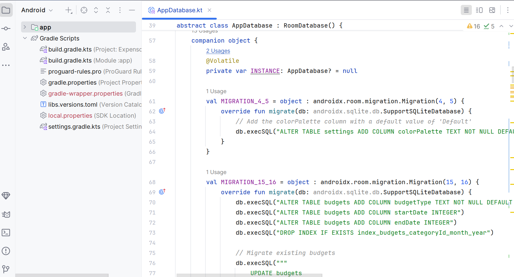</td>
    <td>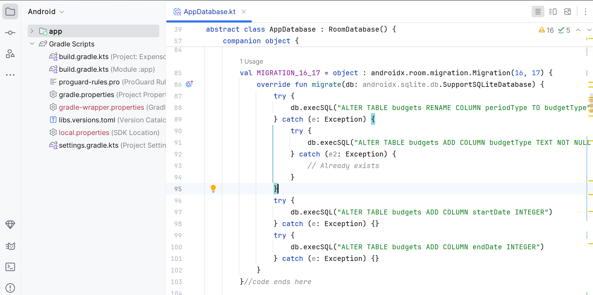</td>
    <td>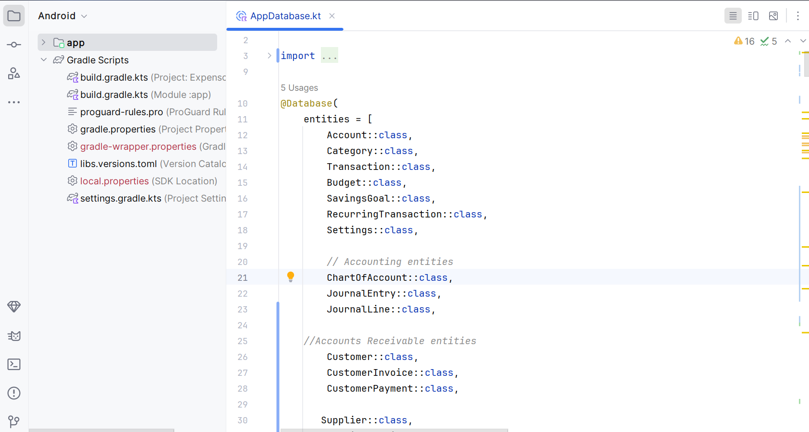</td>
      <td>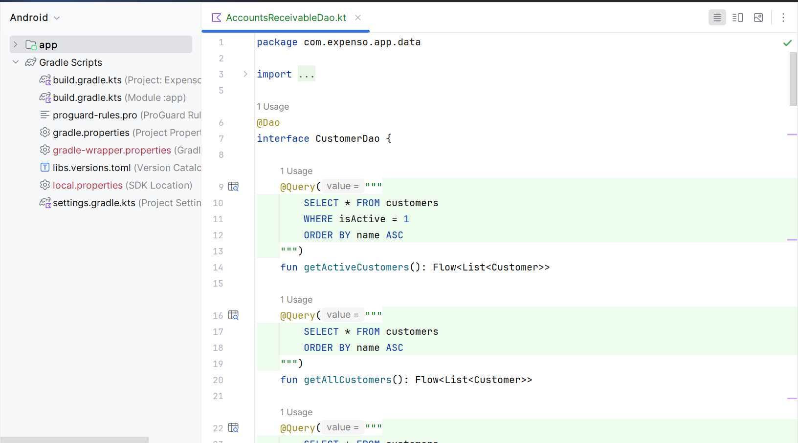</td>
    </tr>
   </table>

---

Testing

The SULVA Accounting System was evaluated using 15 functional test cases.

The testing covered:

- Chart of Accounts.
- Journal entries.
- General Ledger.
- Customer management.
- Customer invoices and payments.
- Supplier management.
- Supplier invoices and payments.
- Trial Balance generation.
- Accounts Receivable.
- Accounts Payable.
- Data validation.
- Data persistence.
- Financial reporting.

All 15 recorded test cases passed, indicating that the tested functions operated according to their expected outcomes.

---

Installation and Setup

The following steps provide a general guide for running the project locally.

1. Install Android Studio.
2. Obtain the SULVA Accounting System source code.
3. Open the project in Android Studio.
4. Allow Gradle to synchronize the project dependencies.
5. Connect a compatible Android device or launch an Android emulator.
6. Build and run the application.

Any additional SDK requirements, configuration steps, or setup instructions should be verified against the project's current Gradle configuration.

---

Future Improvements

Potential improvements for future versions include:

- Cloud database integration and synchronization.
- Multi-user access and role-based permissions.
- Enhanced authentication and data security.
- Automated backup and recovery.
- Integration with supported mobile money and banking services.
- Advanced financial reporting and analysis.
- Inventory and payroll management.
- Additional accounting validation and testing.

These improvements could extend the application's functionality and support more complex business accounting requirements.

---

Author

Abigail Quansah

Project: SULVA Accounting System
Category: Android Application Development / Accounting Software
Programming Language: Kotlin

---

Developed as a software engineering project demonstrating the application of programming, database design, and accounting principles.
